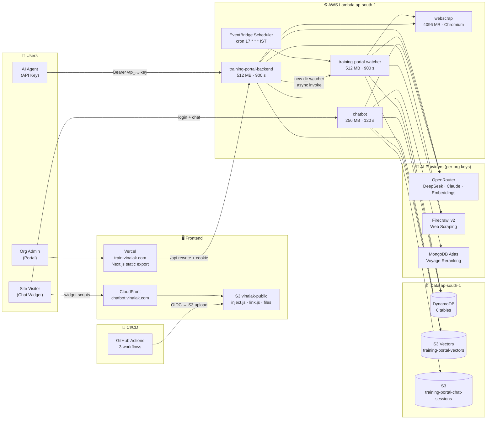

# 🤖 Vinaiak AI Chatbot — Organisational Knowledge Assistant

> Train an AI assistant on your organisation's own knowledge base, then embed it on any website with a single `<script>` tag.

**Live:** [train.vinaiak.com](https://train.vinaiak.com) (Training Portal) · [chatbot.vinaiak.com](https://chatbot.vinaiak.com) (Widget CDN)  
**GitHub:** [ayush14cyber/Vinaiak-Chatbot](https://github.com/ayush14cyber/Vinaiak-Chatbot)  
**Runtime:** Node 22, ES modules, npm workspace  
**Infrastructure:** AWS Lambda `ap-south-1` (Mumbai) · Vercel · S3 Vectors · DynamoDB · CloudFront

---

## 📋 Table of Contents

1. [Overview](#-overview)
2. [Architecture](#-architecture)
3. [Repository Structure](#-repository-structure)
4. [Tech Stack](#-tech-stack)
5. [AWS Infrastructure](#-aws-infrastructure)
   - [Lambda Functions](#lambda-functions)
   - [DynamoDB Tables](#dynamodb-tables)
   - [S3 Buckets](#s3-buckets)
6. [Organisation Lifecycle](#-organisation-lifecycle)
7. [Authentication & Security](#-authentication--security)
   - [Training Portal Auth](#training-portal-trainavinaiacom)
   - [Chatbot Widget Auth](#chatbot-widget-chatbotavinaiacom)
   - [API Keys](#api-keys)
8. [RAG Pipeline](#-rag-pipeline)
   - [Training / Save Pipeline](#training--save-pipeline)
   - [Retrieval Pipeline](#retrieval-pipeline)
   - [Chunk Budget Defaults](#chunk-budget-defaults)
   - [Cohesion Types](#cohesion-types)
   - [Change Detection](#change-detection)
9. [AI Tools (Chat LLM)](#-ai-tools-chat-llm)
10. [Watchers System](#-watchers-system)
    - [File Watcher](#file-watcher)
    - [Directory Watcher](#directory-watcher)
11. [Chatbot Widget Embedding](#-chatbot-widget-embedding)
12. [Streaming & Long-Running Calls](#-streaming--long-running-calls)
13. [Session Limits](#-session-limits)
14. [File Uploads](#-file-uploads)
15. [Portal API Routes](#-portal-api-routes)
16. [Chatbot API Routes](#-chatbot-api-routes)
17. [AI Models & Billing](#-ai-models--billing)
18. [CI/CD](#-cicd)
19. [Environment Variables](#-environment-variables)
20. [Local Development](#-local-development)
21. [Testing](#-testing)
22. [Deployment](#-deployment)
23. [Troubleshooting](#-troubleshooting)

---

## 🌐 Overview

Vinaiak AI Chatbot is a **full-stack, serverless, multi-tenant RAG (Retrieval-Augmented Generation) platform**. Each organisation:

1. Gets its own isolated vector index and knowledge base.
2. Trains the AI by writing pages in a topic tree — or by pointing watchers at live web pages that update themselves every hour.
3. Embeds the resulting chatbot on any website with a single `<script>` tag.

The system has two independently deployed halves that share one document store:

| Half | URL | Purpose |
|---|---|---|
| **Training Portal** | [train.vinaiak.com](https://train.vinaiak.com) | Admins manage the topic tree, scrape web pages, upload files, configure watchers, and style the widget |
| **Chatbot Widget** | [chatbot.vinaiak.com](https://chatbot.vinaiak.com) | CDN origin for `inject.js` and per-org `link.js`; also the chatbot API endpoint |

Everything runs **serverless**: static pages on Vercel, Node.js Express APIs on AWS Lambda, and data in DynamoDB, S3, and S3 Vectors — all in `ap-south-1` (Mumbai). Every AI model call, scrape, and reranking operation is billed to **the organisation's own provider keys**, so costs are always transparent and isolated.

---

## 🏗️ Architecture



---

## 📁 Repository Structure

This is an **npm workspace** (Node 22, ES modules throughout):

```
D:\Vinaiak Chatbot/
├── context-retriever/          # Retrieval engine library (pure logic, no I/O)
│   └── src/
│       ├── config.js           # Chunk budget defaults
│       └── types.js            # Cohesion types (Distinct / Inseparable)
│
├── rag/                        # Models + storage layer
│   └── src/
│       ├── chunker.js          # Agentic chunking via DeepSeek
│       ├── embedder.js         # text-embedding-3-small via OpenRouter
│       ├── reranker.js         # Voyage rerank-3-lite via MongoDB Atlas
│       ├── store.js            # S3 Vectors + DynamoDB operations
│       └── ai.js               # Chat prompt, tools, NDJSON streaming
│
├── chatbot/                    # Chat API — Express 5
│   ├── src/
│   │   └── server.js           # /login, /chat, /reset routes
│   └── client/                 # chatbot-client JS library (browser + Node)
│
├── chatbot-frontend/           # Embeddable widget
│   └── src/                    # esbuild → inject.js (marked + DOMPurify)
│
├── training-portal/
│   ├── backend/                # Portal API + watcher runner — Express 5
│   │   └── src/
│   │       ├── server.js       # All portal API routes
│   │       ├── http.js         # keep-alive / deadline helpers
│   │       └── bin/watcher.js  # Watcher Lambda handler
│   └── frontend/               # Next.js 16, React 19, Tailwind 4
│       └── public/train.md     # Guide for AI agents training an org
│
├── package.json                # Workspace root — scripts + workspaces list
└── README.md
```

### Package Dependency Graph

```
context-retriever
       ↑
      rag
       ↑
training-portal-backend
       ↑
    chatbot
```

`chatbot-frontend` bundles `chatbot-client` (from `chatbot/client`) separately.

---

## 🛠️ Tech Stack

| Layer | Technology | Detail |
|---|---|---|
| **Training Frontend** | Next.js 16, React 19, Tailwind 4 | Static export → Vercel at `train.vinaiak.com` |
| **Widget** | esbuild → `inject.js` | `marked` + `DOMPurify` for safe markdown rendering |
| **Portal Backend** | Express 5, Node 22, ES modules | Lambda Web Adapter, `arm64` |
| **Chatbot Backend** | Express 5, Node 22, ES modules | Lambda Web Adapter, `arm64`, NDJSON streaming |
| **Auth — Portal** | Google Identity Services RS256 JWT | `jose` library, JWKS caching, `httpOnly SameSite=Strict` cookie |
| **Auth — Chatbot** | reCAPTCHA v3 + Google ID token → session JWT | 1-hour JWT, 50 requests/session |
| **API Keys** | `vtp_…` prefix, SHA-256 stored | Bearer header, for AI agent access |
| **AI — Chunking** | `deepseek/deepseek-prover-v2:free` (DeepSeek V4.1 Flash) via OpenRouter | Low reasoning effort |
| **AI — Chat** | `deepseek/deepseek-prover-v2:free` (DeepSeek V4.1 Flash) via OpenRouter | Agentic tool-calling |
| **AI — Embeddings** | `openai/text-embedding-3-small` | 1536 dimensions, via OpenRouter |
| **AI — Media** | `claude/claude-haiku-5.5` | Image/PDF descriptions, via OpenRouter |
| **AI — Reranking** | `voyage/rerank-3-lite` | Via MongoDB Atlas integration |
| **Scraping** | Firecrawl v2 | URL → clean markdown |
| **JS Rendering** | `webscrap` Lambda (Chromium) | JS-rendered pages for watchers |
| **Storage — Vectors** | S3 Vectors bucket `training-portal-vectors` | 1536-dim, one index per org |
| **Storage — Sessions** | S3 `training-portal-chat-sessions` | `sessions/{id}.json` |
| **Storage — Metadata** | DynamoDB (6 tables) | Orgs, admins, keys, documents, watchers |
| **Storage — Public** | S3 `vinaiak-public` + CloudFront | `inject.js`, per-org `link.js`, file attachments |
| **CI/CD** | GitHub Actions (3 workflows) | OIDC for S3 widget publish |
| **Hosting** | AWS Lambda `ap-south-1`, Vercel | See Lambda specs below |

---

## ☁️ AWS Infrastructure

**Region:** `ap-south-1` (Mumbai)

### Lambda Functions

| Function | Memory | Timeout | URL |
|---|---|---|---|
| `training-portal-backend` | 512 MB | 900 s | `https://4lw55iclpbzm3p7twzkuotf76y0odhyj.lambda-url.ap-south-1.on.aws` |
| `training-portal-watcher` | 512 MB | 900 s | No URL — triggered by EventBridge Scheduler `cron(17 * * * ? *)` IST |
| `chatbot` | 256 MB | 120 s | `https://d4l7w3jjxpfu2wkjfqexkmcfuy0ingyn.lambda-url.ap-south-1.on.aws` |
| `webscrap` | 4096 MB | — | `https://w7j2ouzoexsr4fqzfix767hx240nrypa.lambda-url.ap-south-1.on.aws` |

All Lambda functions run `nodejs22.x` on `arm64`. The portal backend and chatbot use **Lambda Web Adapter (LWA)** to wrap their Express servers.

### DynamoDB Tables

| Table | Partition Key | Sort Key | Purpose |
|---|---|---|---|
| `pending_organisations` | `org_id` | — | Orgs awaiting super-admin approval |
| `organisations` | `org_id` | — | Active orgs: name, keys, `chatbot_origins`, widget settings; GSI `by_owner` |
| `org_admins` | `email` | — | Admin's org and allowed folders |
| `org_api_keys` | `key_hash` | — | SHA-256 of `vtp_…` keys; GSI `by_org` |
| `org_documents` | `org_id` | `doc_id` | Chunk IDs per document + file attachments |
| `org_watchers` | `org_id` | `id` | Watcher config, links found, change snapshots |

### S3 Buckets

| Bucket | Contents |
|---|---|
| `training-portal-vectors` *(S3 Vectors)* | 1536-dim embeddings, one named index per org |
| `training-portal-chat-sessions` | `sessions/{id}.json`; `data-not-found/{org}/…` |
| `vinaiak-public` | `public/inject.js`, `public/opener.webp`, `public/{org}/link.js`, `public/{org}/files/{id}/{name}` |

**CloudFront & Vercel:**

| Distribution | Origin | Domain |
|---|---|---|
| CloudFront | S3 `vinaiak-public` | `chatbot.vinaiak.com` |
| Vercel | Next.js static export | `train.vinaiak.com` |

---

## 🏢 Organisation Lifecycle

```
flowchart TD is explained below in numbered steps:
```

1. **Register** — User visits [train.vinaiak.com](https://train.vinaiak.com), signs in with Google, submits registration (`org_id`, org name) → written to `pending_organisations`.
2. **Review** — Super-admin (email listed in `ADMIN_EMAILS`) reviews at `/admin/requests`.
3. **Approve** — On approval:
   - Record moved from `pending_organisations` to `organisations`
   - S3 Vectors index created for the org
   - Creator granted root-folder access in `org_admins`
4. **Configure** — Owner sets OpenRouter, Firecrawl, MongoDB Atlas keys, and allowed chatbot origins.
5. **Invite** — Owner invites additional admins with folder-level access.
6. **API Keys** — Admins create `vtp_…` prefixed keys; SHA-256 stored in `org_api_keys`. Key acts as its creator's identity.
7. **Train** — Add pages, scrape URLs, configure watchers, upload files.
8. **Embed** — Copy one `<script>` tag onto the website.

---

## 🔐 Authentication & Security

### Training Portal (`train.vinaiak.com`)

| Step | Detail |
|---|---|
| Sign-in | Browser obtains Google ID token via Google Identity Services |
| Verification | Server verifies RS256 signature against Google's JWKS (cached with TTL) |
| Session | `httpOnly`, `SameSite=Strict` cookie set on success |
| API Keys | `vtp_…` prefix; plaintext shown once; SHA-256 stored in DynamoDB; sent as `Authorization: Bearer vtp_…` |

### Chatbot Widget (`chatbot.vinaiak.com`)

| Step | Detail |
|---|---|
| Login | Visitor hits `POST /login` with `{org_id, google_captcha_token}` |
| reCAPTCHA | Server verifies token with Google using `GRECAPTCHA_KEY` |
| Origin check | Request `Origin` must be in org's `chatbot_origins` whitelist (or `train.vinaiak.com` for preview) |
| Session JWT | HS256, 1 hour lifetime, bound to org + session ID; set in `httpOnly` cookie |
| Rate limit | Each session JWT allows **50 chat requests** |
| Session resume | Re-login with same session ID resumes prior conversation |

### API Keys

- Prefix: `vtp_…`
- Storage: SHA-256 hash in `org_api_keys` DynamoDB table
- Transport: `Authorization: Bearer vtp_…` header
- Scope: Inherits creator's folder permissions
- Allowed operations: Read tree, read/write pages/folders, scrape, read watchers
- Restricted operations (humans only): Create/edit/delete watchers, manage keys and admins

---

## 🧠 RAG Pipeline

### Training / Save Pipeline

When a page is saved in the training portal, the following steps run in sequence:

```
Page content
     │
     ▼
1. Media Descriptions
   ┌─────────────────────────────────────────────────────────────────┐
   │ Images/PDFs → claude-haiku-5.5 (OpenRouter) → text description │
   │ Description inserted inline in page text                        │
   └─────────────────────────────────────────────────────────────────┘
     │
     ▼
2. Agentic Chunking
   ┌─────────────────────────────────────────────────────────────────┐
   │ Full text (with media descriptions) → DeepSeek V4.1 Flash      │
   │ Model sees numbered lines, returns line-number boundaries only  │
   │ Engine cuts text itself — no content lost or paraphrased        │
   │ Each chunk gets breadcrumb + context                            │
   │ Output: ChunkPlan[] with Distinct / Inseparable cohesion        │
   └─────────────────────────────────────────────────────────────────┘
     │
     ▼
3. Embedding (delta — only changed chunks)
   ┌─────────────────────────────────────────────────────────────────┐
   │ Each chunk → text-embedding-3-small (1536 dims, OpenRouter)     │
   │ FNV-1a 64-bit fingerprints detect unchanged chunks              │
   └─────────────────────────────────────────────────────────────────┘
     │
     ▼
4. Storage
   ┌─────────────────────────────────────────────────────────────────┐
   │ New vectors → S3 Vectors index (org's named index)              │
   │ Chunk IDs → DynamoDB org_documents                              │
   │ Old vectors (chunks page no longer uses) deleted after write    │
   └─────────────────────────────────────────────────────────────────┘
```

### Retrieval Pipeline

When a visitor sends a chat message, the LLM calls the `retrieve` tool:

| Step | Detail |
|---|---|
| **1. Tool call** | LLM decides to call `retrieve(query)` with a plain-language query string |
| **2. Vector search** | `context-retriever` fetches **128 nearest chunks** from the org's S3 Vectors index |
| **3. Group completion** | Inseparable groups are completed — all parts returned even if only one matched |
| **4. Reranking** | Voyage `rerank-3-lite` (MongoDB Atlas) reranks the 128 candidates → best **64** |
| **5. Return** | Top **8 matches** returned (~10 chunks counting inseparable group members), each with source page path |
| **6. Rounds** | At most **5 model rounds** per user message |
| **7. Summarisation** | Session history automatically summarised at **300k tokens** |

> **Without a MongoDB Atlas key:** Reranking is skipped; vector-distance ordering is used. A `degraded` warning is logged to CloudWatch.

### Chunk Budget Defaults

Defined in `context-retriever/src/config.js`:

| Parameter | Value | Meaning |
|---|---|---|
| `targetChars` | 1 800 | Preferred chunk size in characters |
| `maxChars` | 4 000 | Hard maximum per chunk |
| `minChars` | 120 | Minimum viable chunk |
| `overlapChars` | 150 | Overlap between adjacent chunks |
| `maxGroups` | 256 | Max inseparable groups per document |
| `maxPartsPerGroup` | 128 | Max parts within one inseparable group |

### Cohesion Types

Defined in `context-retriever/src/types.js`:

| Type | Behaviour |
|---|---|
| **Distinct** | Chunk can stand alone; retrieval may return it without neighbours |
| **Inseparable** | Chunk must be returned with its entire group (e.g., multi-row fee table, multi-step procedure) |

### Change Detection

- **FNV-1a 64-bit fingerprints** computed on page content before embedding.
- On re-save, only chunks whose fingerprint changed are re-embedded (**delta updates**).
- Old chunk vectors are deleted *after* new ones are written — no search gap during updates.

---

## 🔧 AI Tools (Chat LLM)

The DeepSeek V4.1 Flash chat model has access to three tools:

| Tool | Signature | Purpose |
|---|---|---|
| `retrieve` | `retrieve(query: string)` | Semantic search over org knowledge base → returns chunks + source page paths |
| `offer_options` | `offer_options(options: string[])` | Presents clickable option buttons to the visitor in the widget UI |
| `data_not_found` | `data_not_found(topic: string)` | Logs a missing-data report (stored in S3 `data-not-found/{org}/…`) for training portal review |

The model replies in markdown and cites source URLs. Missing-data reports accumulate in S3 until an admin reviews and dismisses them via the portal's **Missing Data** page.

---

## 👁️ Watchers System

Watchers are stored in DynamoDB `org_watchers` and run on the `training-portal-watcher` Lambda. The EventBridge Scheduler fires the Lambda at **minute 17 of every hour** (IST, `cron(17 * * * ? *)`).

A new directory watcher also triggers an immediate async invocation from the portal backend, so the first import begins at once.

### File Watcher

Follows a **single URL** for content changes:

| Step | Detail |
|---|---|
| **Fetch** | `webscrap` renders the current page via Chromium |
| **Fingerprint** | FNV-1a fingerprint computed on page text |
| **Compare** | Compared with stored snapshot; ignores clocks, counters, relative times ("2 hours ago", "yesterday"), and other noise |
| **Re-import** | If real content changed → Firecrawl scrapes → page saved and re-indexed |

### Directory Watcher

Follows a **list of links** (e.g., a notices board, a year-wise archive):

| Feature | Detail |
|---|---|
| **CSS selector** | Extracts links from a page using a configurable CSS selector |
| **Multi-level** | Multiple levels supported (e.g., year index → per-year page → per-notice page) |
| **Link limit** | Discovers up to **50 links** per run |
| **First/Last N** | Supports first N or last N limits on discovered links per level |
| **Intermediate pages** | In-between pages are read for their links via `webscrap`; content not imported |
| **New links** | Each new link at the last level is scraped with Firecrawl and saved as a page |
| **PDF/image links** | Saved as links; the media step describes them via Claude |
| **Removed links** | Pages for links that disappear or fall outside limits are deleted |
| **Optional file watchers** | First or last N pages can also get file watchers for change tracking |
| **Link store** | All previously-found links persisted in DynamoDB `org_watchers` |

**Watcher run safety:** The Lambda stops starting new work **2 minutes before its 900 s timeout**, and sends `webscrap` requests in batches of 24.

---

## 🧩 Chatbot Widget Embedding

Embed the chatbot on any website with a **single script tag**:

```html
<script src="https://chatbot.vinaiak.com/public/{org_id}/link.js" async></script>
```

### How it works

```
1. link.js (per-org, tiny)
   └── Loads shared inject.js from chatbot.vinaiak.com
   └── Passes org config as data-* attributes

2. inject.js (shared across all orgs, bundled by esbuild)
   └── Injects a launcher button into the host page
   └── Opens chat in an srcdoc iframe
   └── Iframe requests carry the site's own Origin header

3. Widget UI
   └── POST /login with {org_id, google_captcha_token}
   └── Streams POST /chat responses as NDJSON events
   └── Renders markdown using marked + DOMPurify (safe)
   └── Displays clickable options from offer_options tool
```

### Widget Customisation

Admins configure the widget at the portal's `/chatbot` page. `PUT /chatbot` writes the per-org `link.js` to S3. Settings include: chatbot name, greeting message, theme colour, and launcher image.

> **Origin security:** Each org maintains a `chatbot_origins` whitelist. The chatbot Lambda rejects login requests from unlisted origins.

---

## 📡 Streaming & Long-Running Calls

Both APIs use **Lambda Web Adapter (LWA)** with `AWS_LWA_INVOKE_MODE=response_stream`, enabling HTTP streaming from Lambda Function URLs.

### Keep-alive for Long Requests

Vercel's rewrite drops connections with no bytes for 90+ seconds. For cookie-based (browser) calls that are still running at 90 s:

| Step | What happens |
|---|---|
| `200 OK` sent immediately | Response headers committed |
| Every 30 s | A space character (` `) sent as keep-alive (JSON parsers ignore leading whitespace) |
| When done | Actual JSON response body sent |
| On error (after 200) | `{"error": "...", "status": N}` sent |

> **API key calls** (AI agents) bypass Vercel entirely by calling the Lambda URL directly — no keep-alive needed; answered normally.

### Hard Deadline

A graceful deadline at **870 seconds** (30 s before Lambda's 900 s limit) terminates long calls cleanly before Lambda forces a kill.

---

## ⏱️ Session Limits

| Limit | Value |
|---|---|
| Requests per session | **50** |
| JWT lifetime | **1 hour** |
| Session storage | S3 `sessions/{id}.json` |
| Session retention | **1 day** after last write |
| Write safety | Atomic S3 writes using `If-Match` header (prevents race conditions) |

---

## 📎 File Uploads

### Supported Formats

| Type | Formats | Max Size |
|---|---|---|
| Documents | PDF | 20 MB |
| Images | PNG, JPEG, WebP, GIF | 20 MB |

### Upload Flow

```
1. Editor uses placeholder syntax: upload:n (e.g., upload:0, upload:1)
   └── Placeholder can be placed anywhere in page content

2. On Save → POST /files/uploads {id, files}
   └── Backend issues presigned S3 PUT URLs
   └── URL signed with file type, size, and page SHA-256 tag (x-amz-meta-page)

3. Browser uploads directly to S3 vinaiak-public
   └── Bypasses backend (Lambda Function URL max: 6 MB)

4. Placeholders replaced with CloudFront URLs (chatbot.vinaiak.com/public/{org}/files/…)

5. Page saves normally → media step describes uploaded files via claude-haiku-5.5
```

### File Lifecycle

- Files are tagged with the SHA-256 of their page ID on upload.
- On save, the backend reads each upload's tag and adds matching files to the page's `files` set in `org_documents`.
- Pasting a URL from another page does **not** add it to the set.
- The `files` set only grows (removing a link in the editor does not delete the S3 file).
- Deleting a page, or its folder, deletes the associated S3 files (3 retries each).
- Presigned upload URLs expire in **15 minutes**.

---

## 📡 Portal API Routes

All routes served by the `training-portal-backend` Lambda (Express 5). Cookie-authenticated unless noted as API-key accessible.

### Auth & Identity

| Method | Path | Description |
|---|---|---|
| `POST` | `/session` | Sign in with Google ID token → set `httpOnly` cookie |
| `DELETE` | `/session` | Sign out → clear cookie |
| `GET` | `/me` | Return current user profile |

### Organisation Registration

| Method | Path | Description |
|---|---|---|
| `GET` | `/org-ids/available?id=` | Check if `org_id` is available |
| `POST` | `/register` | Submit registration (creates pending record) |
| `POST` | `/join` | Request admin access to an existing org |

### Super-Admin

| Method | Path | Description |
|---|---|---|
| `GET` | `/admin/requests` | List pending registrations |
| `POST` | `/admin/approve` | Approve a pending registration |
| `POST` | `/admin/reject` | Reject a pending registration |
| `GET` | `/admin/orgs` | List all active orgs |
| `PUT` | `/admin/orgs/keys` | Update org-level OpenRouter / Firecrawl keys |
| `PUT` | `/admin/orgs/chatbot-origins` | Set allowed origins for chatbot widget |
| `GET` | `/admin/admins` | List org admins |
| `PUT` | `/admin/admins` | Add or update admin + folder access |
| `DELETE` | `/admin/admins` | Remove admin |

### Content (API-key accessible)

| Method | Path | Description |
|---|---|---|
| `GET` | `/tree` | Get topic tree for the org |
| `GET` | `/files` | Get page content by path |
| `POST` | `/files` | Create new page (triggers full RAG indexing) |
| `PUT` | `/files` | Update page content (triggers delta re-indexing) |
| `DELETE` | `/files` | Delete page and its vectors |
| `POST` | `/files/rename` | Rename a page |
| `POST` | `/files/uploads` | Get presigned S3 URL for file upload |
| `GET` | `/scrape?url=` | Scrape URL with Firecrawl → clean markdown |
| `POST` | `/folders` | Create folder |
| `DELETE` | `/folders` | Delete folder (recursive: pages + files) |
| `POST` | `/folders/rename` | Rename folder |

### Watchers (admin only)

| Method | Path | Description |
|---|---|---|
| `GET` | `/watchers` | List watchers |
| `POST` | `/watchers` | Create watcher (triggers immediate async import) |
| `PUT` | `/watchers` | Update watcher |
| `DELETE` | `/watchers` | Delete watcher |
| `POST` | `/watchers/links` | Manually trigger link discovery |

### API Keys

| Method | Path | Description |
|---|---|---|
| `GET` | `/keys` | List API keys (hashed — plaintext not stored) |
| `POST` | `/keys` | Create API key (returns plaintext once) |
| `DELETE` | `/keys` | Delete API key |

### Chatbot & Missing Data

| Method | Path | Description |
|---|---|---|
| `GET` | `/chatbot` | Get chatbot widget settings |
| `PUT` | `/chatbot` | Update widget settings (name, greeting, colour, etc.) |
| `GET` | `/data-not-found` | List missing-data reports |
| `DELETE` | `/data-not-found` | Clear a missing-data report |

---

## 💬 Chatbot API Routes

All routes served by the `chatbot` Lambda (Express 5).

### `POST /login`

Authenticates a visitor and creates or resumes a session.

**Request body:**
```json
{
  "org_id": "my-college",
  "google_captcha_token": "<reCAPTCHA v3 token>"
}
```

**Response:**
```json
{
  "token": "<session JWT>",
  "resumed": false
}
```

- Verifies reCAPTCHA token with Google.
- Checks `Origin` against org's `chatbot_origins`.
- Issues or resumes a session JWT (HS256, 1 hour, bound to org + session ID).

---

### `POST /chat`

Streams a response to a visitor's message.

**Request body:**
```json
{
  "query": "What are the admission requirements?",
  "images": ["<base64 encoded image>"]
}
```

**Response:** NDJSON stream — one JSON object per line:

| Event type | Shape | Description |
|---|---|---|
| `text` | `{"type":"text","delta":"..."}` | Incremental markdown text from the LLM |
| `function_call` | `{"type":"function_call","name":"retrieve","args":{...}}` | LLM calling a tool |
| `function_response` | `{"type":"function_response","name":"retrieve","result":{...}}` | Tool result |
| `options` | `{"type":"options","items":["..."]}` | Clickable option buttons (`offer_options`) |
| `done` | `{"type":"done"}` | Stream complete |
| `error` | `{"type":"error","message":"..."}` | Error during generation |

---

### `POST /reset`

Clears the conversation history for the current session. Returns `204 No Content`.

---

## 💰 AI Models & Billing

All AI usage is billed to **the organisation's own provider keys** — not to Vinaiak centrally.

| Job | Model | Provider | Billed to |
|---|---|---|---|
| Chunking | DeepSeek V4.1 Flash | OpenRouter | Org's OpenRouter key |
| Chat | DeepSeek V4.1 Flash | OpenRouter | Org's OpenRouter key |
| Embeddings | `text-embedding-3-small` (1536 dims) | OpenRouter | Org's OpenRouter key |
| Media descriptions | `claude-haiku-5.5` | OpenRouter | Org's OpenRouter key |
| Reranking | `voyage/rerank-3-lite` | MongoDB Atlas | Org's MongoDB Atlas key |
| Web scraping | Firecrawl v2 | Firecrawl | Org's Firecrawl key |
| JS page rendering | Chromium (`webscrap` Lambda) | AWS | AWS account (Vinaiak infra) |

> **Model constants** are defined in their respective files under `rag/src/`. The S3 Vectors indexes are created with the embedding model's dimension width — changing the embedding model requires re-indexing all orgs.

---

## 🔄 CI/CD

Three GitHub Actions workflows:

| Workflow | File | Trigger | What it does |
|---|---|---|---|
| **Main CI** | `ci.yml` | Push / PR | `npm ci` at root → all workspace tests → bundles 3 Lambdas with esbuild → stores as artifact |
| **Frontend** | `training-portal-frontend.yml` | Push / PR | Lint → Next.js build check |
| **Widget Deploy** | `chatbot.yml` | Push to `main` | Test client → build widget → gzip `inject.js` → upload to S3 `vinaiak-public` via GitHub OIDC |

### Widget Deploy Details (`chatbot.yml`)

The widget deploy workflow authenticates to AWS via **GitHub OIDC** as a role that may write **only** `s3://vinaiak-public/public/inject.js`. No long-lived AWS credentials are stored in GitHub secrets.

```
push to main
  │
  ├── npm test -w chatbot/client
  ├── npm run build -w chatbot-frontend
  ├── gzip inject.js
  └── aws s3 cp inject.js s3://vinaiak-public/public/inject.js
      (authenticated via OIDC → scoped IAM role)
```

---

## 🔑 Environment Variables

### `training-portal-backend` Lambda

| Variable | Purpose |
|---|---|
| `GOOGLE_CLIENT_ID` | Verify Google ID tokens (RS256, JWKS caching) |
| `ADMIN_EMAILS` | Comma-separated list of super-admin email addresses |
| `AWS_LAMBDA_EXEC_WRAPPER` | `/opt/bootstrap` (Lambda Web Adapter) |
| `AWS_LWA_INVOKE_MODE` | `response_stream` |
| `PORT` | `8080` |

### `chatbot` Lambda

| Variable | Purpose |
|---|---|
| `JWT_SECRET` | Sign and verify session JWTs (HS256) |
| `GRECAPTCHA_KEY` | Verify reCAPTCHA v3 tokens server-side |
| `AWS_LAMBDA_EXEC_WRAPPER` | `/opt/bootstrap` (Lambda Web Adapter) |
| `AWS_LWA_INVOKE_MODE` | `response_stream` |
| `PORT` | `8080` |

### Training Portal Frontend (Vercel)

| Variable | Purpose |
|---|---|
| `NEXT_PUBLIC_GOOGLE_CLIENT_ID` | Google Identity Services in-browser sign-in |
| `PORTAL_API` | Dev only — backend URL for Next.js `/api` proxy |

### Per-Org Secrets (stored in DynamoDB `organisations`)

| Secret | Purpose |
|---|---|
| OpenRouter API key | All AI model calls: chunking, chat, embeddings, media descriptions |
| Firecrawl API key | Web scraping (`/scrape` endpoint and watchers) |
| MongoDB Atlas connection string | Voyage reranking (optional — degrades gracefully if absent) |

---

## 💻 Local Development

> **No local AWS stack.** The APIs use your real AWS credentials and the live `ap-south-1` resources. Use a **dedicated test org** to avoid polluting production data.

### Prerequisites

- Node 22 or later
- AWS credentials configured (`~/.aws/credentials` or env vars) with access to the `ap-south-1` resources
- A test org already approved in the portal

### Setup

```sh
# At the workspace root — links all workspace packages
npm install
```

### Running the Portal Backend

```sh
GOOGLE_CLIENT_ID=<your-google-client-id> \
ADMIN_EMAILS=you@example.com \
npm start -w training-portal-backend
# → http://127.0.0.1:3000
```

### Running the Portal Frontend

```sh
cd training-portal/frontend
npm install
NEXT_PUBLIC_GOOGLE_CLIENT_ID=<your-google-client-id> \
PORTAL_API=http://127.0.0.1:3000 \
npm run dev -- -p 3100
# → http://localhost:3100
# next dev proxies /api/* to PORTAL_API (or the deployed API if unset)
```

### Running the Chatbot Backend

```sh
JWT_SECRET=<any-secret> \
GRECAPTCHA_KEY=<your-recaptcha-key> \
npm start -w chatbot
# → http://0.0.0.0:3000  (same port as portal backend — run one at a time)
```

### Running the Widget Dev Server

```sh
CHATBOT_API_URL=http://localhost:3000 \
npm run dev -w chatbot-frontend
# → http://localhost:8000/demo.html
```

### Running a Watcher Manually

```sh
npm run watcher -w training-portal-backend -- --org YOUR_ORG_ID [--id WATCHER_ID]
```

### Notes

- **Google sign-in** works only on origins listed under _Authorized JavaScript origins_ in the Google OAuth client.
- **The widget demo** at `http://localhost:8000` requires that origin to be in the org's `chatbot_origins` list, and `localhost` to be in the reCAPTCHA key's allowed domains.

---

## 🧪 Testing

| Attribute | Detail |
|---|---|
| **Test runner** | Node.js built-in (`node --test`) |
| **Mode** | Offline — AWS SDK calls are faked/mocked |
| **Run all tests** | `npm test` from workspace root |

### Test Coverage by Package

| Package | Test files | Status |
|---|---|---|
| `context-retriever` | Multiple | ✅ All pass |
| `chatbot-client` | Multiple | ✅ All pass |
| `training-portal-backend` | 3 files | ✅ |
| `chatbot` | 1 file | ✅ |

```sh
# Run all workspace tests
npm test

# Lint and build check for the portal frontend
cd training-portal/frontend
npm run lint
npm run build
```

---

## 🚀 Deployment

### Building the Lambdas

```sh
npm ci

# Portal API (server.mjs + run.sh) and watcher (watcher.mjs)
npm run bundle -w training-portal-backend

# Chatbot API (server.mjs + run.sh)
npm run bundle -w chatbot
```

### One-Time Lambda Configuration

Run once per function when first setting up or changing the runtime/adapter:

```sh
# Chatbot Lambda
aws lambda update-function-configuration \
  --region ap-south-1 \
  --function-name chatbot \
  --runtime nodejs22.x \
  --handler run.sh \
  --layers arn:aws:lambda:ap-south-1:753240598075:layer:LambdaAdapterLayerArm64:25 \
  --environment 'Variables={
    AWS_LAMBDA_EXEC_WRAPPER=/opt/bootstrap,
    AWS_LWA_INVOKE_MODE=response_stream,
    PORT=8080,
    JWT_SECRET=...,
    GRECAPTCHA_KEY=...
  }'

# Portal Backend Lambda (same layer; different env vars)
aws lambda update-function-configuration \
  --region ap-south-1 \
  --function-name training-portal-backend \
  --runtime nodejs22.x \
  --handler run.sh \
  --layers arn:aws:lambda:ap-south-1:753240598075:layer:LambdaAdapterLayerArm64:25 \
  --environment 'Variables={
    AWS_LAMBDA_EXEC_WRAPPER=/opt/bootstrap,
    AWS_LWA_INVOKE_MODE=response_stream,
    PORT=8080,
    GOOGLE_CLIENT_ID=...,
    ADMIN_EMAILS=...
  }'

# Watcher Lambda (no LWA — plain Node handler)
aws lambda update-function-configuration \
  --region ap-south-1 \
  --function-name training-portal-watcher \
  --runtime nodejs22.x \
  --handler watcher.handler
```

> Check the [Lambda Web Adapter releases](https://github.com/awslabs/aws-lambda-web-adapter) for the latest layer ARN version.

### Deploying Code Updates

```sh
# Package and deploy portal backend + watcher
cd training-portal/backend/dist/api
zip -qr ../api.zip .
cd ../watcher
zip -qr ../watcher.zip .
cd ..
aws lambda update-function-code \
  --region ap-south-1 \
  --function-name training-portal-backend \
  --zip-file fileb://api.zip
aws lambda update-function-code \
  --region ap-south-1 \
  --function-name training-portal-watcher \
  --zip-file fileb://watcher.zip

# Package and deploy chatbot (also redeploy when rag/src/ai.js changes)
cd chatbot/dist
zip -qr ../chatbot.zip .
cd ..
aws lambda update-function-code \
  --region ap-south-1 \
  --function-name chatbot \
  --zip-file fileb://chatbot.zip
```

### Deploying the Portal Frontend

```sh
cd training-portal/frontend
npm run build          # writes static export to out/
# Vercel deploys automatically on push to main
```

> **Deploy API changes together.** When a request shape changes, deploy the backend Lambda, the watcher Lambda, and the portal pages in the same release to avoid version skew.

### Widget Deployment

The widget (`inject.js`) is deployed automatically by the `chatbot.yml` GitHub Actions workflow on every push to `main` that touches `chatbot-frontend/` or `chatbot/client/`. Manual build:

```sh
npm run build -w chatbot-frontend   # outputs inject.js
gzip -k inject.js
aws s3 cp inject.js.gz s3://vinaiak-public/public/inject.js \
  --content-encoding gzip \
  --content-type application/javascript \
  --cache-control no-cache
```

---

## 🔧 Troubleshooting

| Symptom | Likely Cause | Fix |
|---|---|---|
| Widget not loading | Wrong `org_id` in `link.js` URL | Check `org_id` spelling; ensure org is approved |
| Login fails (chatbot) | reCAPTCHA key mismatch | Verify `GRECAPTCHA_KEY` env var on the `chatbot` Lambda |
| Portal sign-in loop | `GOOGLE_CLIENT_ID` mismatch | Ensure env var matches the Google OAuth client ID |
| Chat returns empty | No documents trained | Add pages in the training portal and save them |
| Retrieve returns nothing | S3 Vectors index empty | Re-save pages to trigger embedding |
| Reranking not working | No MongoDB Atlas key | Add `mongodb_key` to the org record; retrieval degrades gracefully without it |
| Watcher not running | EventBridge rule disabled | Check EventBridge Scheduler in AWS console (`ap-south-1`) |
| File upload fails | Presigned URL expired | Retry the upload; presigned URLs expire in **15 minutes** |
| Long requests time out | Vercel 60 s limit on cookie calls | Use an API key to call the Lambda URL directly (bypasses Vercel) |
| `data_not_found` reports accumulating | Knowledge gaps in training data | Review reports in portal, add missing content, then dismiss |
| Lambda cold start slow | `arm64` + LWA initialization | Provision concurrency for latency-sensitive workloads |
| Session rate limit hit (50 requests) | High usage in one session | Visitor must re-login to get a fresh session JWT |
| Widget shows on wrong sites | `chatbot_origins` too broad | Restrict `chatbot_origins` to only your org's domains |
| Watcher import stalls | Lambda timeout on large directory | Reduce watcher scope (first/last N limits); check CloudWatch logs for the watcher Lambda |

### Reading Logs

Both APIs write **one structured JSON log line per request** to CloudWatch:

| Log group | Contents |
|---|---|
| `/aws/lambda/training-portal-backend` | Method, path, status, duration ms, org, error reason |
| `/aws/lambda/chatbot` | Method, path, status, duration ms, org, chat timing, `degraded` warning if reranker skipped |
| `/aws/lambda/training-portal-watcher` | Watcher run summary, links found/deleted, re-import count |

---

## 📜 Licence

Copyright © Vinaiak. All rights reserved.
