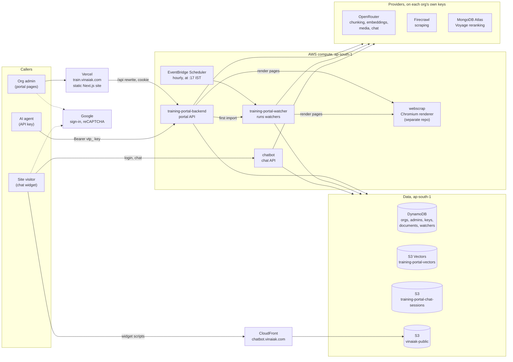

# vinaiak AI chatbot

An organisation, such as a college, trains an AI assistant on its own website and documents, then
puts that assistant on its sites as a chatbot. The system has two halves that share one store of
indexed documents:

- **The training portal** (<https://train.vinaiak.com>). An org's admins, or an AI agent with an
  API key, keep a tree of topics. Each page in it is chunked, embedded and indexed. Watchers keep
  pages in sync with the web on their own, every hour.
- **The chatbot.** A widget a site adds with one `<script>` tag. It answers visitors from the org's
  indexed pages, citing their sources, and reports what it couldn't find back to the portal.

Everything runs serverless: static pages on Vercel, Node.js (Express) APIs on AWS Lambda, and data in DynamoDB,
S3 and S3 Vectors, all in `ap-south-1` (Mumbai). Each org's model, scraping and reranking usage
bills to that org's own provider keys.

## Architecture



## Repository

An npm workspace (Node 22 or later, ES modules everywhere):

| Path | What it is | Runs as |
| --- | --- | --- |
| [`training-portal/frontend`](training-portal/frontend) | The portal's pages: Next.js 16, React 19, Tailwind 4, in JavaScript (`.jsx`), built as a static export with no server functions. `public/train.md` is the guide an AI agent follows to train an org. | Vercel, at `train.vinaiak.com` |
| [`training-portal/backend`](training-portal/backend) | The portal API (Express 5). `src/server.js` serves the API; `src/bin/watcher.js` is the watcher runner. | Lambdas `training-portal-backend` and `training-portal-watcher` |
| [`chatbot`](chatbot) | The chat API (Express 5): `/login`, `/chat`, `/reset`. Uses `rag` and the backend package as libraries. | Lambda `chatbot` |
| [`chatbot/client`](chatbot/client) | `chatbot-client`, a JavaScript library (JSDoc-typed) that signs in with reCAPTCHA and streams replies. | Bundled into the widget |
| [`chatbot-frontend`](chatbot-frontend) | The widget a site embeds, built into one `inject.js` with esbuild. | S3 `vinaiak-public`, behind CloudFront |
| [`rag`](rag) | The models and storage behind `context-retriever`: the chunker, embedder, reranker, media descriptor, and the S3 Vectors + DynamoDB store. Also the chat bot's prompt and tools (`src/ai.js`), and `open-client.js`, the OpenAI-compatible client every model call goes through. | Library |
| [`context-retriever`](context-retriever) | The retrieval engine: agentic chunking, then broad vector search followed by deep reranking. It does no I/O itself. | Library |

The packages depend on each other through the workspace:
`context-retriever` ← `rag` ← `training-portal-backend` ← `chatbot`; `chatbot` also uses `rag`;
`chatbot-frontend` bundles `chatbot-client`.

One piece lives outside this repo: **`webscrap`**, a Node Lambda that renders pages in Chromium, so
script-built pages have their content. Watchers and the link preview use it.

## Hosting

| Piece | Hosted on | Address | Notes |
| --- | --- | --- | --- |
| Portal pages | Vercel | <https://train.vinaiak.com> | A static export (`out/`). `vercel.json` rewrites `/api/*` to the backend's Function URL, so the pages and the API share an origin and the session cookie is first-party. |
| Portal API | Lambda `training-portal-backend`: arm64, 512 MB, 900 s, `nodejs22.x` + Lambda Web Adapter | `https://4lw55iclpbzm3p7twzkuotf76y0odhyj.lambda-url.ap-south-1.on.aws` | The Function URL streams responses and has no CORS. Browsers reach it only through Vercel; API keys call it directly. Env: `GOOGLE_CLIENT_ID`, `ADMIN_EMAILS`. |
| Watcher runner | Lambda `training-portal-watcher`: arm64, 512 MB, 900 s, `nodejs22.x`, no URL | none | EventBridge Scheduler `training-portal-watcher-hourly` starts it with `cron(17 * * * ? *)`, Asia/Kolkata. The backend also invokes it asynchronously for a new directory watcher's first import. Shares the backend's IAM role. |
| Chat API | Lambda `chatbot`: arm64, 256 MB, 120 s, `nodejs22.x` + Lambda Web Adapter | `https://d4l7w3jjxpfu2wkjfqexkmcfuy0ingyn.lambda-url.ap-south-1.on.aws` | The Function URL streams responses. Its CORS allows any origin; the code checks each org's own origins. Env: `JWT_SECRET`, `GRECAPTCHA_KEY`. Role: `training-portal-chatbot`. |
| Widget and per-org scripts | S3 `vinaiak-public`, behind CloudFront | `https://chatbot.vinaiak.com/public/inject.js` and its launcher image `public/opener.webp`, `https://chatbot.vinaiak.com/public/{org}/link.js` | Only `public/*` is readable. Files are served `no-cache`, so a change reaches every site on its next page load. |
| Page rendering | Lambda `webscrap`: Node 22, 4096 MB (separate repo) | `https://w7j2ouzoexsr4fqzfix767hx240nrypa.lambda-url.ap-south-1.on.aws` | Renders pages in Chromium. Its `raw_html` batch mode returns the HTML a CSS selector matched. |

### Data

**DynamoDB tables**

| Table | Key | Holds |
| --- | --- | --- |
| `pending_organisations` | `org_id`; index `by_owner` | Registrations waiting for the master admin. |
| `organisations` | `org_id`; index `by_owner` | Approved orgs: name, empty folders kept, provider keys (`openrouter_key`, `firecrawl_key`, `mongodb_key`), `chatbot_origins`, and the widget's settings. |
| `org_admins` | `email` | Each admin's org and the folders they may change (`""` is the root). |
| `org_api_keys` | `key_hash` (SHA-256); index `by_org` | API keys. A key acts as the admin who made it. |
| `org_documents` | `org_id`, `doc_id` | `rag`'s side index: each document's chunk ids, since S3 Vectors can't list by metadata. The portal adds `files` to a page's row: the uploads it has linked to. |
| `org_watchers` | `org_id`, `id` | Watchers: address, levels, links found, and the hashes and snapshots that changes are compared against. |

**S3**

| Bucket | Holds |
| --- | --- |
| `training-portal-vectors` (S3 Vectors) | One index per org, named by its id: 1536-dimensional embeddings with each chunk's text and metadata. |
| `training-portal-chat-sessions` | `sessions/{id}.json`, conversations, deleted a day after they were last written. `data-not-found/{org}/…`, the chatbot's reports of missing data, kept until an admin dismisses them. |
| `vinaiak-public` | `public/inject.js`, the widget every org shares, and `public/opener.webp`, its launcher's default image; `public/{org}/link.js`, each org's embed script; and `public/{org}/files/{id}/{name}`, the PDFs and images uploaded into pages. |

## How it works

### Signing in and onboarding an org

1. The portal's pages get a Google ID token from Google Identity Services and send it to
   `POST /api/session`. The backend checks it against Google's keys and stores it in an httpOnly,
   `SameSite=Strict` cookie, `__Host-id_token`. It verifies the cookie on every call.
2. A new account registers an org id (`POST /register`), which waits in `pending_organisations`.
3. The master admin, an account listed in `ADMIN_EMAILS`, approves it on `/admin`. They give the org's
   OpenRouter, Firecrawl and MongoDB Atlas keys, and the sites its chatbot may run on. Approval
   creates the org's vector index, moves the org to `organisations`, and gives its creator the
   root folder in `org_admins`.
4. Other people ask to join (`POST /join`), and the master admin gives them folders. The master
   admin can open any org by sending the `x-org` header.

### Training: a topic tree of pages

- **Ids and folders.** A page's id is its path, like `Admissions|UG|Fees`. A folder is any path with
  pages under it. An empty folder is kept in the org's row until a page goes in.
- **Scraping.** `GET /scrape?url=` turns a web page into markdown through Firecrawl, using the
  org's key and `onlyMainContent`. The admin edits the markdown, then saves it.
- **Saving** (`POST`/`PUT /files`) indexes the page through `rag` and `context-retriever`:
  1. **Media.** Claude Haiku 5.5 (OpenRouter) reads each linked image or PDF. Its markdown
     transcription goes inside the link, so the text models downstream can read it. A PDF over 10
     pages gets its table of contents instead.
  2. **Chunking.** DeepSeek V4.1 Flash (OpenRouter, low reasoning effort) sees the page as numbered
     lines and answers with line numbers only. The engine cuts the parts itself, so no text can be
     lost or paraphrased. Each part gets a breadcrumb and context. Passages that only make sense
     whole, like a fee table, are marked inseparable and always come back together.
  3. **Embedding.** OpenAI text-embedding-3-small (OpenRouter) embeds only the chunks that changed.
  4. **Storing.** Vectors go to the org's S3 Vectors index, and chunk ids to `org_documents`. Chunks
     the page no longer uses are deleted last, once the new ones are written.
- **Attaching files.** A PDF or a PNG, JPEG, WebP or GIF image, up to 20 MB (the most the media
  step reads), can be attached in the editor. Each one gets a placeholder link, `upload:n`, that
  the person can move anywhere in the text. On Save, `POST /files/uploads {id, files}` hands out a
  presigned S3 `PUT` for each file. The file's type and size are signed, and so is a tag for the
  page it's for: `x-amz-meta-page`, the SHA-256 of its id. The browser uploads straight to
  `vinaiak-public`, because a Function URL takes at most 6 MB. The placeholders then become the
  files' public URLs on `chatbot.vinaiak.com`, and the page saves as usual, so the media step
  describes the files.
- **Freeing files.** Saving a page reads the tag of each upload its markdown links to, and adds
  the ones tagged with this page to the page row's `files` set. A URL pasted in from another page
  isn't added. The set only grows: removing a link leaves the file. A move copies the set to the
  page's new row. Deleting the page, or its folder, deletes those files, trying each 3 times.
  Agents can upload files the same way (see `train.md`).
- **Reading** a page back rebuilds its text from its chunks.

### AI agents with API keys

- An admin creates a `vtp_…` key in the portal. It is shown once; only its SHA-256 is stored. The
  key acts as its creator, with whatever folders they have at the time; removing those revokes it.
- An agent sends it as `Authorization: Bearer` straight to the Function URL. With a key it can read
  the tree, read and write pages and folders, scrape, and read watchers. Creating, editing or
  stopping a watcher, and managing keys or admins, need a person signed in.
- <https://train.vinaiak.com/train.md> is the guide an agent follows. It covers planning the tree,
  avoiding duplicates of what is already imported or watched, and the costs.

### Watchers

- **A file watcher** follows one web page. Every hour, `webscrap` renders the page. Its text is
  compared with the last snapshot, ignoring things that move on their own: clocks, "5 minutes ago",
  visitor counters, today's date. When something real changed, Firecrawl scrapes the page and it is
  saved again.
- **A directory watcher** follows a list of links, such as notices.
  - Each level's CSS selector picks the list on the page, then on each page the level above links
    to, such as one page per year.
  - Each level can follow only its first or last N links. In-between pages are only read for their
    links, through `webscrap`, at most 50 of them per run.
  - Each new link at the last level is scraped through Firecrawl and saved as a page in the folder.
    A link to a PDF or an image is saved as a link, which the save describes.
  - The page of a link that disappears, or falls outside the limit, is deleted.
  - Optionally, the first or last N of its pages get file watchers too, so they are re-imported
    when they change.
- **Runs.** The hourly schedule starts the watcher Lambda. It sends the pages to `webscrap` in
  batches of 24, and stops starting new work two minutes before its own 900 s timeout. Creating or
  editing a directory watcher validates its list, then invokes the watcher Lambda asynchronously, so
  the import begins at once.

### The chatbot

**Putting it on a site**

1. An admin styles the chatbot on the portal's `/chatbot` page. `PUT /chatbot` writes the org's
   `public/{org}/link.js` to `vinaiak-public`.
2. The site adds `<script src="https://chatbot.vinaiak.com/public/{org}/link.js" async></script>`.
   That script loads the shared `inject.js`, passing the org's settings as `data-*` attributes.
3. `inject.js` adds a button that opens the chat in an iframe built from `srcdoc`. Requests
   therefore carry the site's own `Origin`.
4. CI publishes `inject.js` on every push to `main` that touches the widget or its client.

**Answering a visitor**

1. **`POST /login {org_id, google_captcha_token}`.**
   - The chatbot checks the invisible reCAPTCHA token was solved on the requesting site.
   - It reads the org from `organisations`, and accepts the `Origin` only if it is one of the org's
     chatbot origins, or `https://train.vinaiak.com` for the portal's preview.
   - It creates a session in S3, or resumes the one an earlier token points to, and returns a JWT.
     The JWT lasts one hour and is bound to the org, the session and the site. One login allows 50
     requests.
2. **`POST /chat {query, images}`** streams newline-delimited JSON events: text, tool calls, options,
   then `done`.
   - The model is DeepSeek V4.1 Flash through OpenRouter, billed to the org's key. It can read
     images itself.
   - It calls `retrieve` with a plain-language query. `context-retriever` fetches the 128 nearest
     chunks from the org's index and completes inseparable groups. Voyage `rerank-3-lite`, called
     through MongoDB Atlas with the org's key, then judges the best 64. Each `retrieve` call returns
     the best 8 matches, about 10 chunks once inseparable groups are whole, with their sources.
   - Without an Atlas key, the vector order stands, and the log line warns that the search was
     degraded.
   - The model replies in markdown and cites source URLs. It can call `offer_options` to give the
     visitor buttons, and `data_not_found` to report a gap. It gets at most 5 rounds per message.
   - Conversations are summarised once they pass 300k tokens.
3. Before the stream ends, the session is saved to S3, so Lambda isn't frozen with work pending. A
   `data_not_found` report is written to `data-not-found/{org}/`. The portal's Missing data page
   reads these through `GET /data-not-found`, and an admin dismisses each once it's fixed.
4. **`POST /reset`** starts a new conversation in the same session.

### Calls that take minutes

- **Function URLs stream** (`RESPONSE_STREAM`), so an answer can start before the work ends.
- **Keep-alive** (`serve` in `training-portal/backend/src/http.js`). A save can take minutes, but Vercel's rewrite gives up after 120 s without a byte.
  For cookie calls still running after 90 s, it answers `200`, sends a space every 30 s,
  then the JSON; JSON parsers skip the leading spaces. A failure after that comes back as
  `{"error", "status"}`. API-key calls bypass Vercel and are answered normally.
- **The deadline** (also in `serve`) ends a call with a readable `504` before Lambda's 900 s limit cuts it off.

### Logs

Both APIs write one JSON log line per call to CloudWatch, under `/aws/lambda/training-portal-backend`
and `/aws/lambda/chatbot`. Each line has the method, path, status, time in ms, org, and why the call
failed. The chatbot also logs what answering took, and a `degraded` warning when a search lost its
reranker.

## Models and billing

| Job | Model or service | Through | Billed to |
| --- | --- | --- | --- |
| Chunking pages | `deepseek/deepseek-v4.1-flash-1017` | OpenRouter | The org's OpenRouter key |
| Answering in the chatbot | `deepseek/deepseek-v4.1-flash-1017` | OpenRouter | The org's OpenRouter key |
| Embeddings | `openai/text-embedding-3-small` (1536 dimensions) | OpenRouter | The org's OpenRouter key |
| Describing images and PDFs | `anthropic/claude-haiku-5.5` | OpenRouter | The org's OpenRouter key |
| Reranking | Voyage `rerank-3-lite` | MongoDB Atlas (`ai.mongodb.com`) | The org's MongoDB key (optional) |
| Scraping pages | Firecrawl v2 `scrape` | Firecrawl | The org's Firecrawl key |
| Rendering pages | Chromium | `webscrap` Lambda | AWS |

Each model is a `const` in its file under `rag/src/`. The S3 Vectors indexes are created with the
embedding's width, so changing the embedding model means re-indexing every org.

## CI and deployment

GitHub Actions:

| Workflow | Does |
| --- | --- |
| `ci.yml` | `npm ci` at the root, then every workspace's tests (`npm test`), then bundles the three Lambdas with esbuild and keeps them as an artifact. |
| `training-portal-frontend.yml` | Lint, then build. |
| `chatbot.yml` | Tests the client and builds the widget. On `main`, it gzips `inject.js` and uploads it to `s3://vinaiak-public/public/inject.js`. It authenticates through GitHub's OIDC as a role that may write only that file. |

### The Lambdas

Each API is an ordinary Express server. On Lambda it runs behind the
[AWS Lambda Web Adapter](https://github.com/awslabs/aws-lambda-web-adapter), which turns Function
URL calls into HTTP requests to the server on port 8080 and streams its responses back, so a reply
can start before the work ends. The watcher runner is a plain Node handler.

```sh
npm ci
npm run bundle -w training-portal-backend   # dist/api (server.mjs, run.sh) and dist/watcher (watcher.mjs)
npm run bundle -w chatbot                   # chatbot/dist (server.mjs, run.sh)
```

Once, for each API function (`training-portal-backend` and `chatbot`):

```sh
aws lambda update-function-configuration --region ap-south-1 --function-name chatbot \
  --runtime nodejs22.x --handler run.sh \
  --layers arn:aws:lambda:ap-south-1:753240598075:layer:LambdaAdapterLayerArm64:25 \
  --environment 'Variables={AWS_LAMBDA_EXEC_WRAPPER=/opt/bootstrap,AWS_LWA_INVOKE_MODE=response_stream,PORT=8080,JWT_SECRET=…,GRECAPTCHA_KEY=…}'
```

(the backend's variables are `GOOGLE_CLIENT_ID` and `ADMIN_EMAILS` instead; check the adapter's
README for the layer's latest version), and for the watcher runner `--runtime nodejs22.x --handler
watcher.handler`. The Function URLs keep their `RESPONSE_STREAM` invoke mode. Then, on each deploy:

```sh
cd training-portal/backend/dist/api && zip -qr ../api.zip . && cd ../watcher && zip -qr ../watcher.zip . && cd ..
aws lambda update-function-code --region ap-south-1 --function-name training-portal-backend --zip-file fileb://api.zip
aws lambda update-function-code --region ap-south-1 --function-name training-portal-watcher --zip-file fileb://watcher.zip

# Also redeploy the chatbot after changing the chat prompt or tools in rag/src/ai.js
cd chatbot/dist && zip -qr ../chatbot.zip . && cd ..
aws lambda update-function-code --region ap-south-1 --function-name chatbot --zip-file fileb://chatbot.zip
```

- **Deploy API changes together.** When a request's shape changes, deploy the backend, the watcher
  runner and the portal pages together.
- **The portal pages** are a static export that Vercel serves. `npm run build` writes them to `out/`.

## Local development

There is no local AWS stack. Locally, the APIs use your AWS credentials and the real `ap-south-1`
resources, so use a test org.

```sh
npm install                       # once, at the root: links the workspace packages

# Portal API on http://127.0.0.1:3000
GOOGLE_CLIENT_ID=… ADMIN_EMAILS=you@example.com npm start -w training-portal-backend

# One org's watchers, once
npm run watcher -w training-portal-backend -- --org ORG [--id ID]

# Portal pages on http://localhost:3100, as the API has :3000. `next dev` proxies /api like Vercel
# does: to PORTAL_API, or to the deployed API without it.
cd training-portal/frontend
npm install
NEXT_PUBLIC_GOOGLE_CLIENT_ID=… PORTAL_API=http://127.0.0.1:3000 npm run dev -- -p 3100

# Chat API on http://0.0.0.0:3000. It uses the same port as the portal API, so run one at a time.
JWT_SECRET=… GRECAPTCHA_KEY=… npm start -w chatbot

# Widget demo on http://localhost:8000/demo.html, against the local chat API
CHATBOT_API_URL=http://localhost:3000 npm run dev -w chatbot-frontend
```

- **Google sign-in** works only on origins the Google OAuth client lists under Authorized JavaScript
  origins.
- **The widget demo** works only once `http://localhost:8000` is one of the org's chatbot origins,
  and `localhost` is on the reCAPTCHA key's domains.
- **Tests:** `npm test` at the root runs every package's (Node's built-in test runner, offline);
  `npm run lint` and `npm run build` in `training-portal/frontend`.


